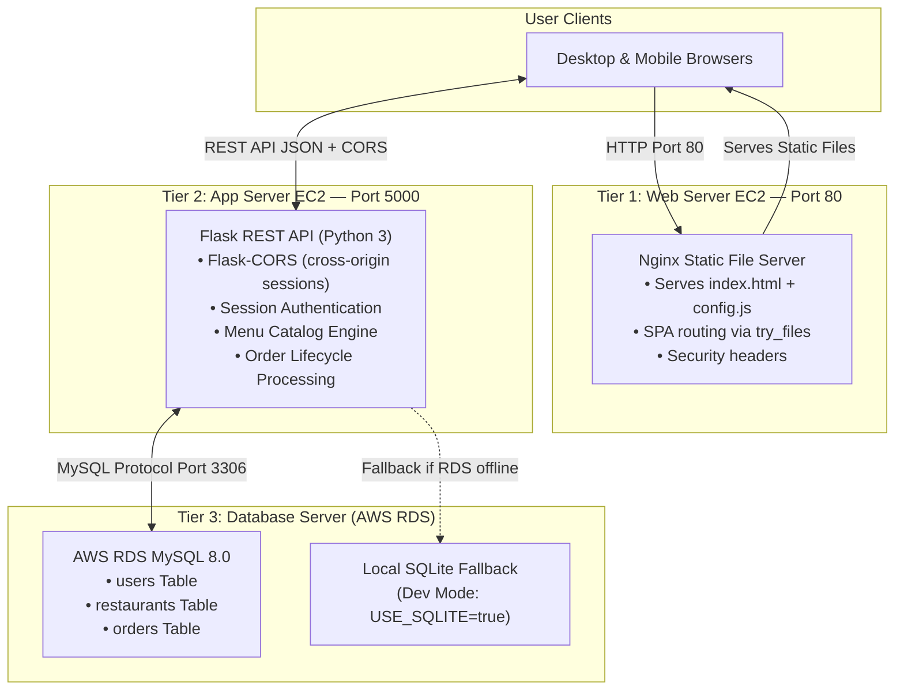

# 3-Tier Zomato Web Application

A cloud-native food ordering and restaurant management platform deployed using a **true 3-Tier Architecture** on Amazon Web Services (AWS), with each tier running on a **separate machine**.

---

## 📌 1. Project Overview

The **3-Tier Zomato Application** separates concerns across three independent layers:

| Tier | Machine | Role |
| :--- | :--- | :--- |
| **Tier 1 — Web Server** | AWS EC2 (Ubuntu) | Nginx serves the static SPA (HTML, CSS, JS) on Port 80 |
| **Tier 2 — App Server** | AWS EC2 (Ubuntu) | Python Flask REST API on Port 5000 — all business logic |
| **Tier 3 — Database Server** | AWS RDS (MySQL 8.0) | Persistent storage — users, restaurants, orders |

> The frontend talks to the backend via cross-origin fetch (CORS + session credentials). The backend talks to the database over Port 3306.

---

## 🏛️ 2. Architecture Diagram



---

## 👥 3. User Roles & Capabilities

| Role | Default Credentials | Permissions |
| :--- | :--- | :--- |
| **👤 Customer** | `user` / `user123` | Browse menu, dynamic `[−][qty][+]` cart, UPI QR payment, view own orders |
| **👨‍🍳 Employee** | `BHARAT` / `Bharat@12345` | Auto-redirect to Kitchen Queue, advance order status: `PLACED→PREPARING→DELIVERED` |
| **👑 Admin** | `admin` / `admin123` | Add/edit/delete dishes, view & manage all orders |

---

## 📂 4. Project Directory Structure

```text
zomatoapp/
├── application/
│   ├── app.py                  # Tier 2: Flask REST API (API only, no static serving)
│   ├── requirements.txt        # Python Dependencies (Flask, Flask-CORS, PyMySQL)
│   └── zomato-app.service      # systemd service for Tier 2 App Server EC2
├── database/
│   └── db.py                   # Tier 3: AWS RDS MySQL connector + SQLite fallback
├── web/
│   ├── index.html              # Tier 1: Single-Page Application (HTML, CSS, JS)
│   ├── config.js               # Tier 1: Set API_BASE to Tier 2 App Server IP here
│   └── nginx.conf              # Tier 1: Nginx config to serve SPA on Port 80
├── run.py                      # App Server runner (Tier 2 + Tier 3 init)
├── .gitignore
└── README.md
```

---

## 🗄️ 5. Database Schema (Tier 3)

```sql
CREATE TABLE IF NOT EXISTS users (
    id INT AUTO_INCREMENT PRIMARY KEY,
    username VARCHAR(50) UNIQUE NOT NULL,
    password VARCHAR(100) NOT NULL,
    role VARCHAR(20) NOT NULL DEFAULT 'user'
);

CREATE TABLE IF NOT EXISTS restaurants (
    id INT AUTO_INCREMENT PRIMARY KEY,
    name VARCHAR(100) NOT NULL,
    item_name VARCHAR(100) NOT NULL,
    price DECIMAL(10, 2) NOT NULL,
    rating DECIMAL(3, 1) NOT NULL
);

CREATE TABLE IF NOT EXISTS orders (
    id INT AUTO_INCREMENT PRIMARY KEY,
    customer_name VARCHAR(100) NOT NULL,
    restaurant_name VARCHAR(100) NOT NULL,
    item_name VARCHAR(100) NOT NULL,
    quantity INT NOT NULL,
    total_price DECIMAL(10, 2) NOT NULL,
    address TEXT NOT NULL,
    status VARCHAR(30) DEFAULT 'PLACED',
    created_at TIMESTAMP DEFAULT CURRENT_TIMESTAMP
);
```

---

## 🔌 6. REST API Endpoints (Tier 2 — Port 5000)

### Authentication
| Method | Endpoint | Description |
|--------|----------|-------------|
| `POST` | `/api/login` | Authenticate + set session |
| `POST` | `/api/register` | Create Customer or Admin account |
| `GET` | `/api/me` | Return active session user |
| `POST` | `/api/logout` | Clear session |

### Menu & Restaurant Management
| Method | Endpoint | Access |
|--------|----------|--------|
| `GET` | `/api/restaurants` | Public |
| `POST` | `/api/admin/restaurants` | Admin only |
| `PUT` | `/api/restaurants/<id>` | Admin + Employee |
| `DELETE` | `/api/restaurants/<id>` | Admin only |

### Orders & Payment
| Method | Endpoint | Access |
|--------|----------|--------|
| `POST` | `/api/order` | Logged-in users |
| `GET` | `/api/orders` | Customer (own) · Admin/Employee (all) |
| `PATCH` | `/api/orders/<id>/status` | Admin + Employee |

---

## 🚀 7. AWS Deployment Guide

### Prerequisites — 3 AWS Resources

| Resource | Type | Details |
| :--- | :--- | :--- |
| **Tier 1 EC2** | t2.micro / Ubuntu 22.04 | Web Server — runs Nginx |
| **Tier 2 EC2** | t2.micro / Ubuntu 22.04 | App Server — runs Flask |
| **Tier 3 RDS** | db.t3.micro / MySQL 8.0 | Database — AWS RDS |

### AWS Security Group Rules

**Tier 1 EC2 (Web Server) — Inbound:**
| Port | Protocol | Source |
|------|----------|--------|
| `22` | SSH | Your IP |
| `80` | HTTP | `0.0.0.0/0` (Anywhere) |

**Tier 2 EC2 (App Server) — Inbound:**
| Port | Protocol | Source |
|------|----------|--------|
| `22` | SSH | Your IP |
| `5000` | Custom TCP | Tier 1 EC2 Security Group (or `0.0.0.0/0` for testing) |

**Tier 3 RDS (Database) — Inbound:**
| Port | Protocol | Source |
|------|----------|--------|
| `3306` | MySQL/Aurora | Tier 2 EC2 Security Group ID |

---

## 🖥️ 8. Setup Instructions

### Step A — Tier 2: App Server EC2 Setup

SSH into your **App Server EC2** and run:

```bash
# 1. Clone the repository
git clone -b 3-tier-application https://github.com/bharatsairamkadali02/zomatoapp.git
cd zomatoapp

# 2. Install Python tools & virtual environment
sudo apt update -y && sudo apt install -y python3-pip python3-venv
python3 -m venv venv
./venv/bin/pip install -r application/requirements.txt

# 3. Install the systemd service
#    IMPORTANT: Edit the service file first — replace TIER1_WEB_SERVER_IP
#               with the actual public IP of your Tier 1 EC2 instance
nano application/zomato-app.service

sudo cp application/zomato-app.service /etc/systemd/system/zomato-app.service
sudo systemctl daemon-reload
sudo systemctl enable zomato-app
sudo systemctl start zomato-app

# 4. Verify service status
sudo systemctl status zomato-app
```

---

### Step B — Tier 1: Web Server EC2 Setup

SSH into your **Web Server EC2** and run:

```bash
# 1. Clone the repository (only web files needed)
git clone -b 3-tier-application https://github.com/bharatsairamkadali02/zomatoapp.git
cd zomatoapp

# 2. IMPORTANT: Set the Tier 2 App Server IP in config.js
#    Replace APP_SERVER_IP with your Tier 2 EC2's public IP
nano web/config.js
# Change:  const API_BASE = 'http://APP_SERVER_IP:5000';
# To:      const API_BASE = 'http://13.235.200.100:5000';  ← Your Tier 2 IP

# 3. Install and configure Nginx
sudo apt update -y && sudo apt install -y nginx

sudo cp web/nginx.conf /etc/nginx/sites-available/zomato
sudo ln -s /etc/nginx/sites-available/zomato /etc/nginx/sites-enabled/zomato
sudo rm -f /etc/nginx/sites-enabled/default

# 4. Test and reload Nginx
sudo nginx -t
sudo systemctl enable nginx
sudo systemctl restart nginx
```

---

## 🌐 9. Accessing the Application

| URL | Route |
| :--- | :--- |
| `http://<TIER1_EC2_IP>/home` | Restaurant Menu & Cart |
| `http://<TIER1_EC2_IP>/cart` | Shopping Cart & Checkout |
| `http://<TIER1_EC2_IP>/orders` | Live Order Management |
| `http://<TIER1_EC2_IP>/login` | Account Sign In |
| `http://<TIER1_EC2_IP>/signup` | Account Registration |

---

## 🧪 10. Verification Checklist

1. **Cross-Origin Session:** Login on Tier 1 UI → session is maintained via Tier 2 Flask across machines.
2. **Dynamic Cart:** Click `+ Add to Cart` on any dish → card changes to `[−] 1 [+]` in real-time.
3. **UPI QR Payment:** Proceed to checkout → scan QR → click `✅ I Have Scanned & Paid` → order saved to RDS.
4. **Employee Workflow:** Login as `BHARAT` → auto-redirected to `/orders` → advance status `PLACED → PREPARING → DELIVERED`.
5. **Admin Panel:** Login as `admin` → Add/Edit/Delete dishes visible on `/home`.
