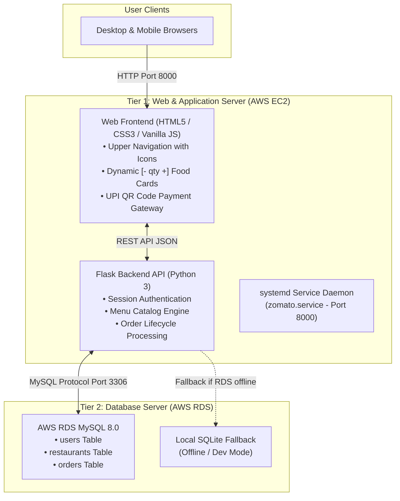

# 2-Tier Zomato Web Application

A cloud-native food ordering and restaurant management platform deployed using a **2-Tier Architecture** on Amazon Web Services (AWS).

---

## 📌 1. Project Overview

The **2-Tier Zomato Application** is an enterprise-pattern web application that provides real-time food browsing, cart management with dynamic item quantity controls, UPI QR Code payment integration, and multi-role operations for Customers, Employees, and Administrators.

### Architecture Model:
* **Tier 1 — Web & Application Tier (AWS EC2):**
  * **Presentation Layer:** Responsive single-page interface built with HTML5, CSS3, and Vanilla JavaScript with path-based client-side routing (`/home`, `/cart`, `/orders`, `/login`, `/signup`).
  * **Application / Logic Layer:** Python Flask REST API handling user authentication, menu catalog management, order processing, and payment gateway simulation.
* **Tier 2 — Database Tier (AWS RDS MySQL):**
  * Managed MySQL 8.0 relational database on AWS RDS handling persistent storage for users, menu items, and customer orders. Includes automatic fallback to local SQLite for offline development.

---

## 🏛️ 2. Architecture Diagram



---

## 👥 3. User Roles & Capabilities

| Role | Access Type | Default Credentials | Permissions & Key Features |
| :--- | :--- | :--- | :--- |
| **👤 Customer** | Public Signup & Login | `user` / `user123` | • Browse restaurant dishes<br/>• Real-time `[ - ] [qty] [ + ]` counter on dish cards<br/>• Add items to cart & review bill breakdown<br/>• Scan dynamic UPI QR Code to pay<br/>• View personal order history & live order status |
| **👨‍🍳 Employee** | Private Pre-seeded Account *(Hidden from public signup)* | `BHARAT` / `Bharat@12345` | • **Automatic direct redirect to Live Kitchen Queue (`/orders`) on login**<br/>• View all incoming customer orders across restaurants<br/>• Advance order status: `PLACED` &rarr; `PREPARING` &rarr; `DELIVERED`<br/>• Fix and update food prices and ratings on the menu |
| **👑 Admin** | Public / Privileged Account | `admin` / `admin123` | • Full administrative authority across the platform<br/>• Add new restaurants & dishes with price/rating<br/>• Update/fix prices and dish details<br/>• Delete dishes from the menu<br/>• View all platform orders and process fulfillment |

---

## 📂 4. Project Directory Structure

```text
zomatoapp/
├── application/
│   ├── app.py             # Tier 1 Backend: Flask REST API & Web Page Routing
│   └── requirements.txt   # Python Dependencies (Flask, PyMySQL, Cryptography)
├── database/
│   └── db.py              # Tier 2 Database: AWS RDS MySQL connector + SQLite fallback & CRUD queries
├── web/
│   └── index.html         # Tier 1 Frontend: Single-Page Application (HTML, CSS, JS)
├── run.py                 # Multi-Tier Application Runner (Port 8000)
├── .gitignore             # Git ignore rules (__pycache__, *.db, venv/)
└── README.md              # Project Documentation & Architecture Guide
```

---

## 🗄️ 5. Database Schema (Tier 2)

### `users` Table
Stores user credentials and roles.
```sql
CREATE TABLE IF NOT EXISTS users (
    id INT AUTO_INCREMENT PRIMARY KEY,
    username VARCHAR(50) UNIQUE NOT NULL,
    password VARCHAR(100) NOT NULL,
    role VARCHAR(20) NOT NULL DEFAULT 'user'
);
```

### `restaurants` Table
Stores restaurant details, menu items, and pricing.
```sql
CREATE TABLE IF NOT EXISTS restaurants (
    id INT AUTO_INCREMENT PRIMARY KEY,
    name VARCHAR(100) NOT NULL,
    item_name VARCHAR(100) NOT NULL,
    price DECIMAL(10, 2) NOT NULL,
    rating DECIMAL(3, 1) NOT NULL
);
```

### `orders` Table
Stores customer orders, delivery addresses, and fulfillment states.
```sql
CREATE TABLE IF NOT EXISTS orders (
    id INT AUTO_INCREMENT PRIMARY KEY,
    customer_name VARCHAR(100) NOT NULL,
    restaurant_name VARCHAR(100) NOT NULL,
    item_name VARCHAR(100) NOT NULL,
    quantity INT NOT NULL,
    total_price DECIMAL(10, 2) NOT NULL,
    address TEXT NOT NULL,
    status VARCHAR(30) DEFAULT 'PLACED',
    created_at TIMESTAMP DEFAULT CURRENT_TIMESTAMP
);
```

---

## 🔌 6. REST API Endpoints (Tier 1)

### Authentication
* `POST /api/register` &mdash; Create new Customer or Admin account *(Employee registration is restricted)*.
* `POST /api/login` &mdash; Authenticate user session.
* `GET /api/me` &mdash; Retrieve active session user profile and role.
* `POST /api/logout` &mdash; Clear session.

### Menu & Restaurant Management
* `GET /api/restaurants` &mdash; Fetch all restaurant menu items.
* `POST /api/admin/restaurants` &mdash; Admin endpoint to add a new dish and restaurant.
* `PUT /api/restaurants/<id>` &mdash; Admin and Employee endpoint to update price and rating.
* `DELETE /api/restaurants/<id>` &mdash; Admin endpoint to remove a dish from the menu.

### Orders & Payment
* `POST /api/order` &mdash; Place order with delivery address, calculate subtotal + ₹30 delivery fee.
* `GET /api/orders` &mdash; Retrieve orders (Customers see only their own; Employees & Admins see all).
* `PATCH /api/orders/<id>/status` &mdash; Advance status (`PLACED` &rarr; `PREPARING` &rarr; `DELIVERED`).

---

## 🚀 7. AWS Deployment & Setup Guide

### Prerequisites
* 1x **AWS EC2 Instance** (Ubuntu 22.04 or 24.04 LTS, t2.micro / t3.micro free-tier).
* 1x **AWS RDS MySQL Instance** (MySQL 8.0, db.t3.micro).

### AWS Security Group Rules:
* **EC2 Security Group (Inbound):**
  * `SSH`: Port `22` &rarr; Your IP
  * `Custom TCP`: Port `8000` &rarr; `0.0.0.0/0` (Anywhere IPv4)
* **RDS Security Group (Inbound):**
  * `MySQL/Aurora`: Port `3306` &rarr; EC2 Security Group ID

---

### Step-by-Step Installation on EC2

#### 1. Clone the Repository
```bash
git clone https://github.com/bharatsairamkadali02/zomatoapp.git
cd zomatoapp
```

#### 2. Install Python Tools & Set Up Virtual Environment
```bash
sudo apt update -y
sudo apt install -y python3-pip python3-venv

python3 -m venv venv
./venv/bin/pip install -r application/requirements.txt
```

#### 3. Configure 24/7 Background Service (systemd)
Create a systemd unit file so the application starts automatically on boot:
```bash
sudo tee /etc/systemd/system/zomato.service > /dev/null << 'EOF'
[Unit]
Description=Zomato 2-Tier Web Application
After=network.target

[Service]
User=ubuntu
WorkingDirectory=/home/ubuntu/zomatoapp
ExecStart=/home/ubuntu/zomatoapp/venv/bin/python3 run.py
Restart=always
RestartSec=3

[Install]
WantedBy=multi-user.target
EOF
```

#### 4. Enable and Start the Application
```bash
sudo systemctl daemon-reload
sudo systemctl enable zomato
sudo systemctl start zomato
```

#### 5. Verify Service Status
```bash
sudo systemctl status zomato
```

---

## 🌐 8. Accessing the Application

Open your browser and navigate to:
```text
http://<EC2_PUBLIC_IP>:8000/home
```

### Available Path Routes:
* `http://<EC2_PUBLIC_IP>:8000/home` &mdash; Restaurant Dishes & Dynamic Card Controls
* `http://<EC2_PUBLIC_IP>:8000/cart` &mdash; Shopping Cart & Checkout
* `http://<EC2_PUBLIC_IP>:8000/orders` &mdash; Live Order Management & Kitchen Queue
* `http://<EC2_PUBLIC_IP>:8000/login` &mdash; Account Sign In
* `http://<EC2_PUBLIC_IP>:8000/signup` &mdash; Account Registration

---

## 🧪 9. Verification & Testing

### Verification Checklist:
1. **Dynamic Quantity Selector:** Click `+ Add to Cart` on any item on `/home`. The card immediately changes to `[ − ] 1 [ + ]` and updates the cart counter in the upper navbar.
2. **UPI QR Code Payment:** Proceed to checkout in `/cart`, enter delivery address, scan QR Code, and click `✅ I Have Scanned & Paid`. Order is recorded in RDS MySQL.
3. **Employee Workflow:** Login with `BHARAT` / `Bharat@12345`. User is automatically redirected directly to `/orders` (Kitchen Queue) and can change status from `PLACED` &rarr; `PREPARING` &rarr; `DELIVERED`.
4. **Signup Role Guard:** Visit `/signup`. Verify only `Customer` and `Admin` roles are available.
